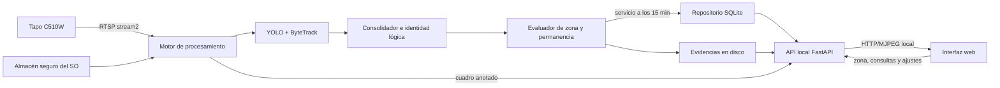
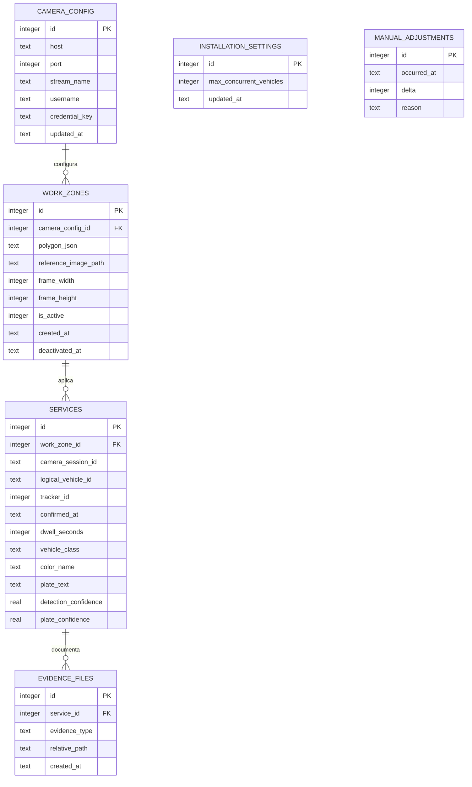

# Diseño técnico: Conteo diario de servicios de lavado

## Visión general



La solución será un monolito modular ejecutado en la PC del lavadero. El motor de cámara, seguimiento y conteo vive fuera de la sesión del navegador, por lo que recargar la interfaz no reinicia temporizadores. Una API local entrega estado, video y operaciones a una interfaz web adaptable; SQLite conserva los eventos y la configuración, mientras las imágenes se almacenan como archivos referenciados por la base.

## Componentes y responsabilidades

### Captura de cámara

- Abre y mantiene el flujo RTSP `stream2`.
- Publica el último cuadro disponible y el estado de conexión.
- Reintenta con espera progresiva ante cortes.
- Obtiene la contraseña desde el almacén seguro del sistema operativo.
- No decide si existe un servicio ni escribe directamente en la base.

### Detección y seguimiento

- Reutiliza el modelo YOLO actual para vehículos.
- Usa ByteTrack mediante `model.track(..., persist=True)` para asignar IDs entre cuadros consecutivos.
- Produce observaciones técnicas: ID de track, caja, clase, confianza y centro inferior.
- Aplica supresión independiente de clase y consolidación espacial para reducir cajas duplicadas del mismo vehículo.
- No usa patente o color como identidad obligatoria.

### Consolidador e identidad lógica

- Separa el `tracker_id` transitorio de un `logical_vehicle_id` estable, que es la unidad real de permanencia y conteo.
- Asocia observaciones nuevas con vehículos lógicos existentes usando continuidad temporal y posición como señales principales; coincidencia de patente es evidencia fuerte y color es evidencia auxiliar.
- Compara el núcleo y el punto inferior del vehículo para reducir el impacto de puertas, capó o baúl abiertos sobre la caja completa.
- No consolida cajas solo por superposición: dos vehículos en fila conservan identidades distintas cuando sus bases aparecen a profundidades diferentes en la imagen.
- Resuelve la asignación de todas las observaciones del cuadro en conjunto y garantiza como máximo una observación principal por vehículo lógico.
- Mantiene como máximo la capacidad configurada para la zona. Una observación sobrante nunca abre un temporizador adicional mientras todos los lugares lógicos estén ocupados.
- Conserva internamente los IDs técnicos asociados para diagnóstico, pero no los presenta como identidad al operador.
- No une un vehículo que efectivamente salió y luego volvió a entrar; ese caso continúa fuera del MVP.

### Evaluador de zona

- Determina si el punto representativo de cada vehículo está dentro del polígono configurado.
- Mantiene una máquina de estados por vehículo lógico: `fuera`, `presente`, `contabilizado`, `perdido`.
- Usa tiempo monotónico para medir 15 minutos durante la ejecución y fecha/hora local para auditar eventos.
- Tolera pérdidas visuales breves mediante una gracia configurable inicial de 10 segundos; una ausencia mayor finaliza la permanencia regular.
- Emite como máximo un servicio por vehículo lógico y sesión de cámara.
- No intenta unir un vehículo que salió y volvió.

### Enriquecimiento y evidencia

- Mantiene la mejor captura del vehículo durante su permanencia.
- Estima color y ejecuta patente/OCR con una frecuencia menor que la detección.
- Estima el color sobre la franja media-baja de la caja, priorizando píxeles cromáticos de carrocería y descartando parabrisas, ventanas, ruedas, sombras y reflejos acromáticos.
- Cuando dos cajas se superponen por perspectiva, excluye del muestreo del vehículo trasero los píxeles ocupados por el vehículo más cercano.
- Al confirmar el servicio guarda captura general y, si existe, recorte de patente.
- Un fallo de OCR o color no bloquea el servicio.

### Repositorio SQLite

- Aplica migraciones versionadas e idempotentes al iniciar.
- Persiste cámara no secreta, zona, servicios y ajustes manuales.
- Calcula el total como `servicios automáticos + suma de ajustes`, nunca como contador mutable independiente.
- Usa consultas parametrizadas y transacciones para escrituras relacionadas.
- No almacena la contraseña ni imágenes binarias.

### API local

- Expone estado, historial, configuración de zona y ajustes manuales solamente en `127.0.0.1` para el MVP.
- Entrega video anotado como MJPEG y datos como JSON.
- Valida coordenadas, motivos y reglas de total no negativo.
- No expone RTSP ni secretos al navegador.

### Interfaz web

- Muestra tablero diario, cámara en vivo, tracks activos e historial.
- Permite dibujar un polígono sobre una captura de referencia y guardarlo.
- Permite ajustes `+1/-1` con confirmación y motivo.
- Consume la API; no ejecuta modelos ni calcula servicios.
- Pasa por `ux-designer` antes de escribir HTML/CSS/JavaScript.

## Modelo de datos



Reglas del esquema:

- Nombres `snake_case`, tablas en plural y PK enteras explícitas.
- Fechas ISO 8601 con offset de zona horaria guardadas como texto.
- `polygon_json` contiene puntos normalizados entre `0` y `1`; `CHECK` y validación de aplicación exigen al menos tres puntos válidos.
- Solo una zona puede estar activa para la cámara; se refuerza con índice único parcial.
- `installation_settings.max_concurrent_vehicles` es un entero positivo y vale `2` inicialmente en esta instalación.
- `services` tiene unicidad por `(camera_session_id, logical_vehicle_id)` para impedir dobles conteos aunque cambie el track técnico. `tracker_id` queda como dato diagnóstico del momento de confirmación.
- `manual_adjustments.delta` admite únicamente `-1` o `1`; el repositorio rechaza un total final negativo dentro de una transacción.
- Índices para historial por `confirmed_at`, ajustes por `occurred_at` y evidencias por FK.
- Las imágenes usan rutas relativas bajo `data/evidence/YYYY-MM-DD/`; no se guardan BLOBs.

## Estructura de carpetas propuesta

```text
DetectaImages/
├── app.py
├── src/
│   └── detecta_images/
│       ├── camera.py
│       ├── tracking.py
│       ├── counting.py
│       ├── evidence.py
│       ├── database.py
│       ├── migrations.py
│       ├── models.py
│       ├── api.py
│       └── settings.py
├── web/
│   ├── index.html
│   ├── app.js
│   └── styles.css
├── migrations/
│   └── 0001_initial.sql
├── data/
│   ├── detecta_images.db
│   └── evidence/
├── tests/
│   ├── unit/
│   ├── integration/
│   └── fixtures/
├── detect_vehicles.py
└── run_tapo.ps1
```

`detect_vehicles.py` y `run_tapo.ps1` se conservan como herramienta de diagnóstico mientras el nuevo motor se construye por módulos.

## Decisiones de arquitectura (resumen, ver ADRs)

### Interfaz

1. **Web local con FastAPI + HTML/JS:** recomendada. Separa motor y presentación, permite canvas para la zona y facilita una evolución remota sin requerir Node en el MVP.
2. **PySide6:** buena experiencia de escritorio, pero agrega una dependencia grande y acopla más el ciclo de la ventana al motor.
3. **Streamlit:** rápido para demos, pero su modelo de reejecución dificulta un motor continuo y una interacción precisa de canvas.

### Persistencia

1. **SQLite:** recomendada. Transaccional, consultable, incluida en Python y migrable a un servidor SQL en una etapa comercial.
2. **JSON/CSV:** simples al inicio, pero frágiles ante escrituras concurrentes, correcciones y consultas históricas.
3. **PostgreSQL:** apropiado para múltiples instalaciones centralizadas, pero innecesario y más costoso para el MVP local.

### Seguimiento

1. **ByteTrack más una capa local de identidad lógica:** recomendado. Conserva el detector actual, corrige cambios y duplicados de track con el contexto específico de una zona fija y permite aplicar la capacidad física sin una dependencia nueva.
2. **BoT-SORT con ReID como identidad directa:** puede mejorar algunas oclusiones, pero las partes móviles también alteran la apariencia; consume más recursos y no expresa por sí solo la capacidad del lavadero.
3. **Patente como identidad primaria:** ofrece una señal muy fuerte cuando se lee, pero falla si está tapada, borrosa o fuera de cuadro y por eso se descarta como requisito obligatorio.

### Credenciales

1. **`keyring` + almacén del sistema operativo:** recomendado para operación continua sin contraseña en SQLite o archivos.
2. **Prompt en cada inicio:** seguro y ya probado, pero impide arranque automático.
3. **`.env`:** descartado para contraseña por persistirla en texto claro.

## Dependencias a agregar

- `fastapi`: API y servidor de la interfaz local.
- `uvicorn`: ejecución ASGI local.
- `keyring`: integración con el almacén seguro de credenciales del sistema operativo.
- No se agrega una librería de tracking: Ultralytics 8.4.67 instalado ya incluye ByteTrack y soporta `persist=True` entre cuadros consecutivos, según su [documentación oficial](https://docs.ultralytics.com/modes/track).
- SQLite se usa mediante `sqlite3` de la biblioteca estándar; no requiere servidor ni paquete adicional, según la [documentación de Python](https://docs.python.org/3/library/sqlite3.html).

Las versiones exactas se fijarán al implementar después de validar compatibilidad con Python 3.14 y realizar una instalación de prueba.

## Plan de implementación por etapas

1. **Dominio aislado:** identidad lógica, capacidad máxima, máquina de estados de permanencia, geometría de zona y reloj inyectable; probar segundos en lugar de esperar 15 minutos reales.
2. **Persistencia:** migración inicial SQLite, repositorios parametrizados y pruebas de reinicio, unicidad y ajustes.
3. **Seguimiento offline:** integrar ByteTrack y evaluar videos existentes con uno y dos vehículos; generar un reporte de cambios de ID y oclusiones.
4. **Evidencias:** seleccionar mejor captura, color y patente opcional; guardar rutas relativas de forma atómica con el servicio.
5. **Motor de cámara:** bucle independiente, reconexión y estado observable sin interfaz.
6. **UX:** ejecutar `ux-designer` para validar flujo, wireframes, estados y sistema visual.
7. **API e interfaz:** implementar tablero, MJPEG, configuración de polígono, historial y ajustes.
8. **Calibración real:** reconectar la Tapo, fijar posición, dibujar zona y ejecutar pruebas aceleradas con umbrales cortos.
9. **Piloto:** observar jornadas reales con conteo paralelo manual y medir falsos positivos, omisiones e IDs intercambiados antes de usar 15 minutos en producción.

### Ajuste posterior al primer piloto real

1. Agregar la capacidad máxima persistida, con valor inicial `2`, y exponerla en configuración.
2. Separar observaciones de ByteTrack de las identidades lógicas visibles y contables.
3. Consolidar detecciones superpuestas y asociar cambios de track por posición, continuidad, patente y color.
4. Migrar la unicidad del servicio desde `tracker_id` hacia `logical_vehicle_id` sin alterar los servicios ya registrados.
5. Probar con secuencias sintéticas y con capturas reales: puertas/baúl abiertos, cambio de track, detecciones duplicadas, dos autos y exceso de observaciones sobre la capacidad.
6. Ejecutar un piloto con umbral corto antes de volver a operar con 15 minutos.

Cada etapa termina con tests y una demostración independiente; la API del sistema de lavados comienza únicamente después de aprobar el piloto local.

## Riesgos técnicos y mitigaciones

- **Cambio de ID o cajas duplicadas al abrir partes móviles:** identidad lógica por encima de ByteTrack, consolidación espacial, asociación por múltiples señales y unicidad por vehículo lógico.
- **Dos autos superpuestos:** ubicar la cámara para maximizar separación visual y probar el caso con videos reales.
- **Límite de capacidad usado para ocultar una asociación incorrecta:** el límite es una última barrera de seguridad; se registran observaciones descartadas para calibrar la asociación y no confundir capacidad con reconocimiento.
- **Movimiento de cámara:** desactivar patrullaje, guardar imagen de referencia y requerir recalibración; detección automática queda como mejora.
- **Reinicio durante una permanencia:** los servicios confirmados persisten; una permanencia aún no confirmada se reinicia en el MVP para evitar acreditar tiempo no observado.
- **Corte RTSP:** pausar temporizadores durante ausencia de cuadros y reintentar; nunca inferir permanencia sin video.
- **Crecimiento de evidencias:** política de retención deberá definirse antes del piloto prolongado; inicialmente medir volumen diario.
- **Concurrencia SQLite:** un único escritor del motor y transacciones breves; la API consulta y solicita operaciones al mismo repositorio.
- **Datos personales:** patente e imágenes permanecen locales; antes de comercializar se debe definir base legal, retención y controles de acceso.
- **Python 3.14:** verificar FastAPI, Uvicorn y keyring con instalación controlada antes de fijar versiones.
