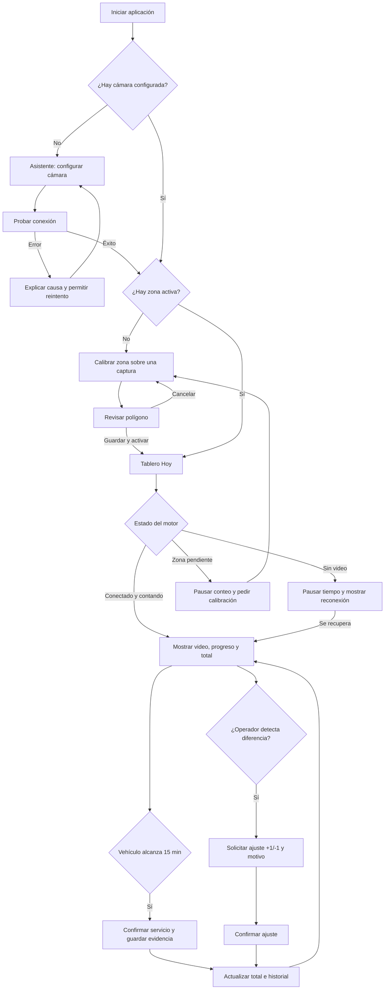

# UX/UI: Conteo diario de servicios de lavado

## Objetivo de la experiencia

La tarea diaria del operador es confirmar de un vistazo cuántos servicios válidos se realizaron, comprobar que la cámara y el conteo funcionan y corregir excepcionalmente una diferencia. La acción más importante es mantener el sistema **contando correctamente**; configurar la cámara y la zona es una tarea ocasional y queda subordinada al tablero.

Contexto asumido:

- Uso frecuente durante toda la jornada desde una PC del lavadero.
- Pantalla principal optimizada para `1024 px` o más; funcional desde `768 px`.
- Una cámara, una zona y una capacidad máxima de vehículos configurable por instalación; valor inicial `2` en este lavadero.
- Interfaz en español, sin requerir conocimientos técnicos de RTSP, YOLO o tracking.

## Arquitectura de información

- **Hoy:** tablero operativo, cámara, vehículos activos y actividad reciente.
- **Historial:** lista completa por fecha, evidencias y ajustes.
- **Configuración:** conexión de cámara, credencial y calibración de zona.
- **Configuración de operación:** capacidad física máxima de la zona, independiente de las credenciales.
- **Estado global persistente:** conexión, conteo activo/pausado y última actualización.

La navegación principal contiene solo estas tres secciones. “Hoy” es la entrada predeterminada.

## Ajuste UX: capacidad e identidad estable

La persona configura este valor una sola vez al instalar el sistema o cuando cambia físicamente el espacio de trabajo. En **Configuración**, debajo de la conexión de cámara, se agrega:

```text
┌─ Operación del lavadero ──────────────────────────────────────┐
│ Capacidad de la zona                                          │
│ [ 2 ]  vehículos simultáneos                                 │
│ Cantidad máxima de vehículos que caben realmente en la zona. │
│                                                              │
│                                  [Guardar capacidad]          │
└──────────────────────────────────────────────────────────────┘
```

- El campo es numérico, obligatorio y admite enteros desde `1`.
- Al guardar muestra progreso, éxito o el error junto al campo.
- Si cambia el valor mientras hay vehículos pendientes, solicita confirmación: los temporizadores pendientes se reinician para aplicar el nuevo límite; los servicios ya confirmados no cambian.
- El tablero muestra nombres estables como **Vehículo 1**, **Vehículo 2**, hasta la capacidad configurada. Nunca muestra IDs internos del tracker.
- Si el detector produce observaciones adicionales, no se crean tarjetas ni temporizadores por encima de la capacidad.

## Flujo principal



## Flujo de calibración de zona

1. El sistema pausa el conteo y obtiene una captura actual.
2. Muestra la advertencia: “La cámara debe quedar fija y sin patrullaje”.
3. El operador marca al menos tres puntos alrededor del área de trabajo.
4. Puede arrastrar puntos, deshacer el último o borrar y comenzar nuevamente.
5. La interfaz rellena el polígono con transparencia y muestra una vista previa.
6. “Guardar y activar zona” solicita confirmación porque reemplaza la calibración anterior.
7. Al guardar, el sistema vuelve al tablero y muestra “Conteo activo”.

Casos límite:

- Sin imagen: no permite dibujar; ofrece reintentar conexión.
- Menos de tres puntos o polígono inválido: deshabilita guardar y explica el motivo.
- Cambio de resolución: escala los puntos normalizados; si la proporción cambia significativamente, solicita revisión.
- Salir sin guardar: conserva la zona anterior y mantiene el conteo pausado si la recalibración fue iniciada por cambio de cámara.

## Wireframe 1: Tablero “Hoy”

```text
┌─────────────────────────────────────────────────────────────────────────────┐
│ DetectaImages      Hoy   Historial   Configuración       ● Conteo activo   │
├─────────────────────────────────────────────────────────────────────────────┤
│ HOY · 7 de octubre                                                        │
│ ┌─────────────────────┐  ┌─────────────────┐  ┌──────────────────────────┐ │
│ │  12                 │  │  11 automáticos │  │ Cámara conectada        │ │
│ │  Servicios de hoy   │  │  +1 ajuste      │  │ Último cuadro: ahora    │ │
│ │ [Ajustar conteo]    │  │                 │  │ Zona: activa            │ │
│ └─────────────────────┘  └─────────────────┘  └──────────────────────────┘ │
│                                                                             │
│ CÁMARA EN VIVO                                      [Configurar zona]      │
│ ┌──────────────────────────────────────────┐ ┌────────────────────────────┐ │
│ │                                          │ │ VEHÍCULOS ACTIVOS          │ │
│ │  imagen + polígono de zona              │ │                            │ │
│ │  caja “Vehículo 24”                     │ │ Auto 24 · gris            │ │
│ │                                          │ │ 12:43 / 15:00  ███████░   │ │
│ │                                          │ │ Pendiente                  │ │
│ │                                          │ │                            │ │
│ │                                          │ │ Auto 31 · blanco           │ │
│ │                                          │ │ 04:10 / 15:00  ██░░░░░░   │ │
│ └──────────────────────────────────────────┘ └────────────────────────────┘ │
│                                                                             │
│ ACTIVIDAD RECIENTE                               [Ver historial completo]   │
│ 14:32  [imagen] AB123CD · gris       Servicio automático              +1   │
│ 13:55  [—]      Corrección manual    “Lavado no detectado”             +1   │
│ 13:10  [imagen] Patente no reconocida · azul  Servicio automático      +1   │
└─────────────────────────────────────────────────────────────────────────────┘
```

Jerarquía:

1. Total del día.
2. Estado “Conteo activo/pausado/error”.
3. Cámara y progreso de vehículos presentes.
4. Evidencias recientes.

Acción primaria contextual: **Resolver problema** si el conteo está detenido; en estado normal no se fuerza ninguna acción. Acciones secundarias: **Ajustar conteo** y **Configurar zona**.

## Wireframe 2: Estado detenido o incompleto

```text
┌─────────────────────────────────────────────────────────────────────────────┐
│ ⚠ Conteo pausado: no se reciben imágenes de la cámara desde las 14:38.     │
│ Los temporizadores están detenidos; no se inferirá tiempo sin video.        │
│ [Reintentar conexión]                           [Revisar configuración]     │
├─────────────────────────────────────────────────────────────────────────────┤
│ Total de hoy: 12 (conservado)                                               │
│                                                                             │
│ ┌─────────────────────────────────────────────────────────────────────────┐ │
│ │ Sin video disponible                                                    │ │
│ │ Verificá que la cámara esté encendida y conectada a la misma red.        │ │
│ └─────────────────────────────────────────────────────────────────────────┘ │
└─────────────────────────────────────────────────────────────────────────────┘
```

El error no reemplaza el total ni el historial. Siempre explica si los temporizadores están activos o pausados.

## Wireframe 3: Configurar zona

```text
┌─────────────────────────────────────────────────────────────────────────────┐
│ ← Volver a Hoy                  Configurar zona de trabajo                  │
├─────────────────────────────────────────────────────────────────────────────┤
│ Conteo pausado durante la calibración                                      │
│ 1. Dejá la cámara fija y desactivá el patrullaje.                           │
│ 2. Marcá el contorno del área donde se realizan los lavados.                │
│                                                                             │
│ ┌───────────────────────────────────────────────────────┐ ┌───────────────┐ │
│ │ Captura de referencia                                │ │ Puntos: 5     │ │
│ │       ●────────────────────●                          │ │               │ │
│ │       │ zona semitransparente                         │ │ [Deshacer]    │ │
│ │       ●────────────────────●                          │ │ [Borrar zona] │ │
│ │                    ●                                  │ │               │ │
│ └───────────────────────────────────────────────────────┘ │ Cámara fija ✓ │ │
│                                                           └───────────────┘ │
│ [Cancelar]                             [Guardar y activar zona]             │
└─────────────────────────────────────────────────────────────────────────────┘
```

La acción primaria es **Guardar y activar zona**. Se habilita con un polígono válido. “Borrar zona” es destructiva y solicita confirmación.

## Wireframe 4: Historial

```text
┌─────────────────────────────────────────────────────────────────────────────┐
│ Historial                                                                  │
│ Fecha [07/10/2026]   Tipo [Todos ▼]   Patente [________]   [Aplicar]       │
├─────────────────────────────────────────────────────────────────────────────┤
│ Total final: 12      Automáticos: 11      Ajustes: +1                      │
│                                                                             │
│ Hora   Evidencia   Patente       Color    Origen        Permanencia         │
│ 14:32  [miniatura] AB123CD       Gris     Automático    15:00      [Ver]    │
│ 13:55  —           —             —        Ajuste +1     —           [Ver]    │
│ 13:10  [miniatura] No reconocida Azul     Automático    15:00      [Ver]    │
│                                                                             │
│ Estado vacío: “No hay servicios ni ajustes para esta fecha”.               │
└─────────────────────────────────────────────────────────────────────────────┘
```

“Ver” abre un panel o modal con captura ampliada, recorte de patente si existe, fecha, origen y confidencias técnicas dentro de una sección secundaria.

## Wireframe 5: Ajuste manual

```text
┌──────────────────────────────────────────────┐
│ Ajustar conteo de hoy                        │
│                                              │
│ Tipo de ajuste                               │
│ (●) Sumar un servicio   ( ) Restar uno       │
│                                              │
│ Motivo                                       │
│ [__________________________________________] │
│ Explicá brevemente por qué se corrige.        │
│                                              │
│ Total actual: 12  →  Nuevo total: 13         │
│                                              │
│ [Cancelar]              [Confirmar ajuste]   │
└──────────────────────────────────────────────┘
```

El motivo es obligatorio. Si restar produciría un total negativo, la opción queda deshabilitada con explicación textual.

## Wireframe 6: Configuración de cámara

```text
┌─────────────────────────────────────────────────────────────────────────────┐
│ Configuración de cámara                                                     │
├─────────────────────────────────────────────────────────────────────────────┤
│ Dirección IP       [192.168.1.41       ]                                    │
│ Puerto RTSP        [554                ]                                    │
│ Flujo              [stream2 ▼          ]                                    │
│ Usuario de cámara  [operador           ]                                    │
│ Contraseña         [••••••••••••       ] [Cambiar]                          │
│                                                                             │
│ Estado: ● Conectada · Última prueba 14:40                                   │
│                                                                             │
│ [Probar conexión]                                  [Guardar configuración]  │
└─────────────────────────────────────────────────────────────────────────────┘
```

La contraseña nunca se vuelve a mostrar. “Probar conexión” entrega resultado explícito antes de guardar. Cambiar cámara o flujo advierte que la zona puede requerir recalibración.

## Estados del sistema

| Estado | Indicador | Comportamiento | Acción ofrecida |
|---|---|---|---|
| Iniciando | Spinner + “Iniciando modelos” | Total e historial visibles; video cargando | Esperar |
| Sin configurar | Gris + texto | No inicia conteo | Configurar cámara |
| Sin zona | Advertencia | Video visible; conteo pausado | Configurar zona |
| Contando | Verde + texto | Video y temporizadores activos | Ninguna obligatoria |
| Reconectando | Ámbar + tiempo | Temporizadores pausados | Reintentar / revisar |
| Error | Rojo + causa segura | Conteo pausado | Resolver problema |
| Calibrando | Azul + texto | Conteo pausado | Guardar o cancelar |

Los estados usan icono, color y texto; nunca solo color.

## Sistema visual

### Paleta

| Token | Valor | Uso |
|---|---|---|
| `color-bg` | `#F1F5F9` | Fondo general |
| `color-surface` | `#FFFFFF` | Tarjetas, tabla y modales |
| `color-text` | `#0F172A` | Texto principal |
| `color-text-muted` | `#475569` | Texto secundario |
| `color-border` | `#CBD5E1` | Bordes y divisores |
| `color-primary` | `#1D4ED8` | Acción principal y foco |
| `color-primary-hover` | `#1E40AF` | Hover principal |
| `color-success` | `#15803D` | Conectado y contabilizado |
| `color-warning` | `#B45309` | Pausa y reconexión |
| `color-error` | `#B91C1C` | Error y acción destructiva |
| `color-zone` | `rgba(37, 99, 235, 0.25)` | Relleno de zona |

Texto normal usa combinaciones con contraste WCAG AA mínimo `4.5:1`; los colores semánticos se acompañan con icono y texto.

### Tipografía

- Familia: `Inter`, con fallback `system-ui, sans-serif`.
- `12 px`: metadatos y etiquetas auxiliares.
- `14 px`: tablas y controles.
- `16 px`: texto base.
- `20 px`: títulos de sección.
- `36 px`: cifra principal del total diario.
- Altura de línea entre `1.4` y `1.5`.

### Espaciado y forma

- Base: `4 px`; escala `4, 8, 12, 16, 24, 32`.
- Altura mínima de controles: `40 px`.
- Radio: `8 px` en controles y `12 px` en tarjetas/modales.
- Sombras suaves solo para modales y paneles elevados; la jerarquía normal usa bordes.

## Componentes base

- **Botón primario/secundario/destructivo:** normal, hover, focus de `2 px`, deshabilitado y cargando con texto estable.
- **Campo de formulario:** label persistente, ayuda, error textual y estado deshabilitado.
- **Tarjeta de métrica:** valor, etiqueta, desglose y estado opcional.
- **Badge de estado:** icono + texto; nunca únicamente color.
- **Barra de progreso:** tiempo transcurrido y valor textual accesible.
- **Tabla/lista de actividad:** encabezados, estado vacío, carga y error.
- **Modal de confirmación:** título específico, consecuencia, acción principal explícita y cancelar.
- **Visor de cámara:** loading, video, sin señal, polígono y cajas con etiquetas legibles.
- **Editor de polígono:** agregar, arrastrar, deshacer, borrar, validación y uso por teclado mediante lista editable de puntos como alternativa accesible.
- **Toast/aviso:** éxito o error inmediato; los errores persistentes permanecen además en la pantalla.

## Accesibilidad y usabilidad

- Orden de tabulación lógico y foco visible en cada control.
- Navegación y modales operables por teclado; `Escape` cancela sin guardar.
- Campos con `label`; placeholders solo como ejemplo.
- Progreso expuesto como texto y semántica accesible, no únicamente como barra.
- Miniaturas con texto alternativo que describe hora, vehículo y patente disponible.
- El video no es la única fuente de estado: vehículos activos se listan en texto.
- Confirmación obligatoria para borrar zona, cambiar cámara y realizar ajustes.
- Mensajes de error sin credenciales ni jerga técnica innecesaria.
- La reducción de movimiento del sistema operativo desactiva animaciones no esenciales.

## Decisiones y límites del MVP

- El tablero y el historial pueden convivir en una sola carga, pero se presentan como secciones navegables para reducir saturación.
- La configuración avanzada del tracker, confidencias y gracia de 10 segundos no se expone al operador en el MVP.
- No se incorpora control PTZ; la interfaz insiste en mantener la cámara fija.
- No se muestra ni edita la futura integración con la API del lavadero.
- El diseño móvil completo y el uso remoto quedan para la etapa comercial.
